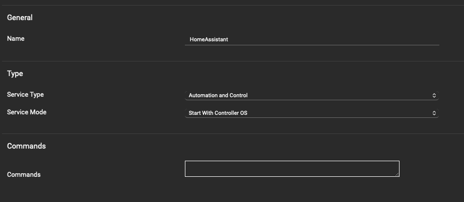
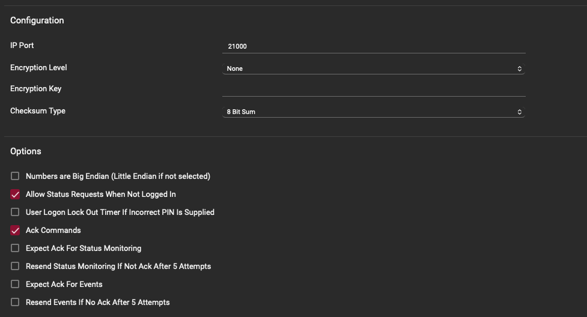
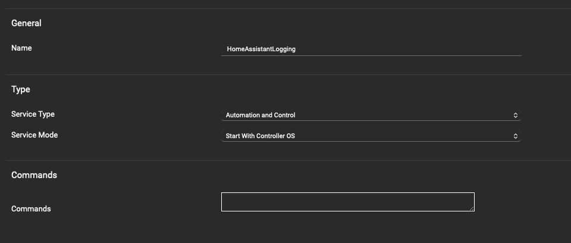
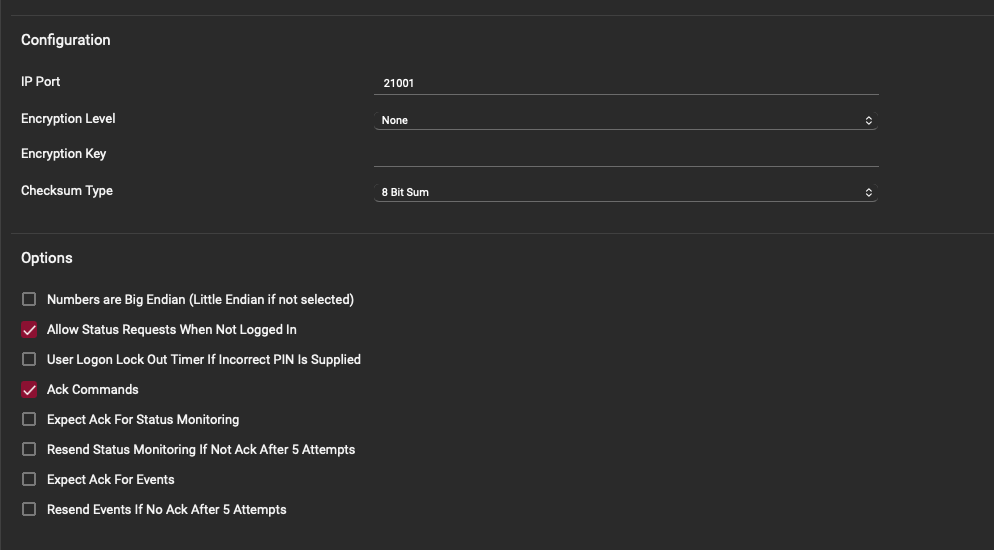

<p align="center">
  
</p>

# ICT Protege for Home Assistant

Local control of **ICT Protege WX** panels. Every door, area, input, output and trouble input is found and added automatically.
There are two ways to connect:

* **Automation and Control service** (recommended): push-based, instant updates, and arm codes are checked by the panel.
  It needs the panel's *Automation and Control* licence.
* **Web interface only**: for panels without that licence. It logs in to the WX web interface as a limited operator
  and watches the panel's event log, so it needs no licence. See [Web-only mode](#web-only-mode).

Setup always asks for a web interface operator, then looks for the control service and uses it if it answers.
If it doesn't, the integration runs on the web interface and offers to switch over when the control service turns up later.

> [!NOTE]
> [ha-protege-wx](https://github.com/olliemaller/ha-protege-wx) is another integration that works through the WX web interface.

## What you get

| Panel record | Home Assistant |
| --- | --- |
| Panel | A controller device with firmware and serial, a **Fault** sensor (on when any trouble input is active or any input is tampered, listing which), a **Rescan panel** button, and (optional) a **Panel event** entity |
| Door | A device with a **lock** (lock, unlock latched, *open* = momentary unlock), a **contact** sensor and a **door state** sensor (closed, open, left open, forced open) |
| Area | A device with an **alarm panel** (away = normal arm, home = stay, night = instant), **alarm** and **siren** sensors, **Allow arm away / home / night** switches to hide arm modes that area doesn't use, and an **Alarm cause** sensor (the zone that set the alarm off, kept until disarm). With a WX operator set, also **Open zones** and **Ready to arm** |
| Input | A device with a state sensor, a **Tamper** sensor (tamper or short on its wiring) and a **Bypass** switch. Use *Show as* in the entity settings to make it a door, window, motion or smoke sensor |
| Output | A device with a switch |
| Trouble input | A diagnostic problem sensor on the controller, disabled by default |

Every door, area, input and output is its own device, so each one can go in its own Home Assistant area
(a PIR in the lounge, a reed on the garage door). Inputs and outputs are listed under the module they are wired to.

Names come from the panel's WX web interface when an operator login is set (see below), otherwise from the module
reference, for example `Input ZX001:03`. Anything you rename in Home Assistant keeps your name.

**Open zones** and **Ready to arm** only count zones that must be closed for the area to arm. Zones whose input type
isn't tested at arming (for example *Delay No Test*), 24 hour zones and trouble zones are left out. When an arm is refused,
the error names the open zones.

With the events service set up, a **duress, panic or medical** alarm raises a critical alert under
**Settings > Repairs** that stays until you mark it handled, and fires an `ict_automation_emergency` event for automations.

Actions: `ict_automation.force_arm` (alarm panel), `ict_automation.turn_on_for` (output, with a duration) and
`ict_automation.bypass` (bypass switch, optionally permanent).

## How PINs are used

* **Integration PIN** (set during setup): a panel user with rights to doors, outputs and bypass. It does **not** need arm or disarm rights.
  The integration watches the panel without being logged in, and logs in with this PIN only for the moment it sends a command.
* **Arming and disarming** always ask for the person's own code, which goes straight to the panel. Home Assistant never stores it.
* **Events user** (optional): a view-only user with no control rights, used only on a separate events service.
* **WX operator** (optional): a web interface operator that can only view programming, used only to read names.

When the panel refuses a command (wrong code, no rights, door in lockdown, input cannot be bypassed) the reason is shown in Home Assistant.

## Setup on the ICT side

All of this is done in the Protege WX web interface. Without the Automation licence, only the operator (step 4) is needed;
see [Web-only mode](#web-only-mode) for the rights to give it.

You don't need the `ACPUseDisplayOrder` command. Without it the control service uses the same record IDs as the web interface,
which the integration reads directly. Panels that already have it set work too: records are then matched by display order.

### 1. Control service (needs the Automation licence)

Go to **Automation > Services**, add a service, and set:

| Setting | Value |
| --- | --- |
| Name | Anything, for example `HomeAssistant` |
| Service Type | Automation and Control |
| Service Mode | Start With Controller OS |
| IP Port | `21000` (any free port) |
| Encryption Level | None |
| Checksum Type | 8 Bit Sum |
| Numbers are Big Endian | **Off** (little endian) |
| Allow Status Requests When Not Logged In | **On** (required) |
| User Logon Lock Out Timer | Off |
| Ack Commands | **On** (required) |
| Expect Ack For Status Monitoring / Events, and both Resend options | **Off** |

<p>
  
  
</p>

The panel allows one connection per service, so give Home Assistant its own service rather than sharing one
used by another system (Savant, Control4 and so on).

### 2. Integration user (with the control service)

Under **Users**, create a user for Home Assistant with a PIN and rights to the doors, outputs and inputs (for bypass)
you want to control. Leave out arm and disarm rights: arming always uses the person's own code.
Using its own user (rather than another system's) keeps the panel's event log clear about who did what.

### 3. Events service and user (optional)

For panel events (who badged, what was unlocked, inputs, alarms) in Home Assistant:

1. Add a **second** Automation and Control service with the same settings on another port, for example
   `HomeAssistantLogging` on `21001`.
2. Create a user with a PIN and **no control rights**. The integration stays logged in on this service only to receive events.

<p>
  
  
</p>

### 4. WX operator (required)

The control service carries no names or zone settings, so the integration reads them from the web interface.
Enable HTTPS on the controller and create an operator for Home Assistant. With the control service, its role only needs to **view** programming.
It logs in once at start-up (and on Rescan), reads names, which areas each input is in and their input types, then logs out.
No session is kept open, and only read requests are sent, so this operator never changes anything.
Requires firmware 4.00.1676 or later.

## Web-only mode

If your WX has the Automation and Control licence, use the control service instead: it is faster, and the panel itself checks arm codes.
Without the licence, setup finds no control service and carries on through the web interface.

**On the ICT side**, enable HTTPS on the controller (firmware 4.00.1676 or later) and create an operator just for Home Assistant.
Give its role only what you want Home Assistant to do: view status and events, plus control of the doors, areas, outputs and
inputs (bypass) it should operate. Don't share this operator with people, so their logins and Home Assistant's session stay separate.

**How it stays connected**: the integration keeps one session, reads only the event log about every two seconds, and re-reads a
status table only when an event says something in it changed (plus a full read every 30 seconds). The session cookie is saved, so a
restart of Home Assistant carries on with the same session instead of logging in again. If the session is dropped it logs in again,
but never more than 6 times an hour, backing off up to 10 minutes between tries. If the panel rejects the password it stops trying
and asks you to re-enter it from **Settings > Devices & services**, so it can't lock the operator out. It logs out when the integration is unloaded.

**Arm codes**: the web interface has no way to check a keypad code, so pick one when you add the integration (change it later under **Configure**):

* **Codes checked in Home Assistant**: add a name and code for each person. Codes are stored only as salted hashes, and the person's
  name shows as *changed by* on the alarm panel.
* **No code**: anyone who can use the alarm panel in Home Assistant can arm and disarm. Use Home Assistant users and permissions to limit that.

Everything else in [What you get](#what-you-get) works the same, including open zones, ready to arm, alarm cause and emergency alerts.
Events show up in the **Panel event** entity and logbook a second or two after they happen.

**Switching to the control service later**: every 6 hours, and when you press **Rescan panel**, the integration checks whether the
control service answers on the port given at setup (usually `21000`). When it does, **Settings > Repairs** offers to switch over;
you can also do it any time from **Configure > Switch to the Automation and Control service**. Enter the integration PIN and the
same devices and entities carry on, with their history, on the control service. From then on it stays on the control service and
never falls back to the web interface; if the service stops answering, the entities show as unavailable until it's back.

## Install

### HACS

Add this repository as a custom repository (category *Integration*), download **ICT Protege**, and restart Home Assistant.

### Manual (side-load)

1. Copy `custom_components/ict_automation` into your Home Assistant `config/custom_components/` folder
   (so you have `config/custom_components/ict_automation/manifest.json`).
2. Restart Home Assistant.

## Setup on the Home Assistant side

1. **Settings > Devices & services > Add integration > ICT Protege**.
2. Enter the controller's IP address, the operator name and password, the HTTPS port (usually `443`) and the
   control service port (usually `21000`).
3. If the control service answers, enter the integration PIN (or tick *Use the web interface only instead*).
   If it doesn't, choose how arming codes work (see [Web-only mode](#web-only-mode)).
   Every door, area, input, output and trouble input is found, named and added.
4. With the control service, open the integration's **Configure** (the cog on the hub) for the optional extras:
   * **Names and zone settings**: change or remove the WX operator. Names are read on every start and when you press **Rescan panel**.
   * **Event logging**: the events service port (`21001`) and the events user's PIN.
5. Tidy up the devices:
   * Put each door, input and output device in its Home Assistant area.
   * **Disable** any area you don't use, for example a system area that only exists for monitoring.
   * On each area's device, turn off the **Allow arm …** switches for modes that area doesn't use; they disappear from its alarm panel.
   * Set *Show as* on inputs (motion, door, window, smoke) so they get the right icon.

### Seeing events

With event logging on, every panel event appears in three places:

* The **Panel event** entity on the controller device, with `text`, `category` and `user` attributes.
  Its types are `access_granted`, `access_denied`, `armed`, `disarmed`, `alarm`, `door`, `input`, `output`, `user`, `trouble` and `other`.
* The **Activity** (logbook) page, as readable text such as *User Dave Entry Granted Front Door Using User By Card*.
* The `ict_automation_event` bus event, with `text`, `category`, `user` and `code`, for automations.

Card numbers are removed from event text so they don't end up in Home Assistant's history.

### Troubleshooting

* **Cannot connect**: check the IP and port, that the service is set to *Start With Controller OS*, and that nothing else is connected to that service.
* **Panel refused a request**: turn on *Allow Status Requests When Not Logged In* on the service.
* **Changes from other systems are slow to show**: check *Ack Commands* is on and both *Expect Ack* options are off.
* For details, turn on debug logging from the integration's menu, reproduce the problem, then turn it off again.
  PINs and codes are never written to the log.

### Upgrading from 1.x

Existing entries are migrated automatically: the connection details are kept, the old hand-entered doors, areas, inputs and outputs are
removed, and everything is re-created from the panel. Entity IDs change, so update dashboards and automations afterwards.

## Development

```bash
pip install -r requirements_test.txt
pytest
```

Tests run against a simulated panel (`tests/fake_panel.py`) built from ICT's *Automation and Control Service* protocol document.
The protocol client in `custom_components/ict_automation/protege/` has no Home Assistant imports.
