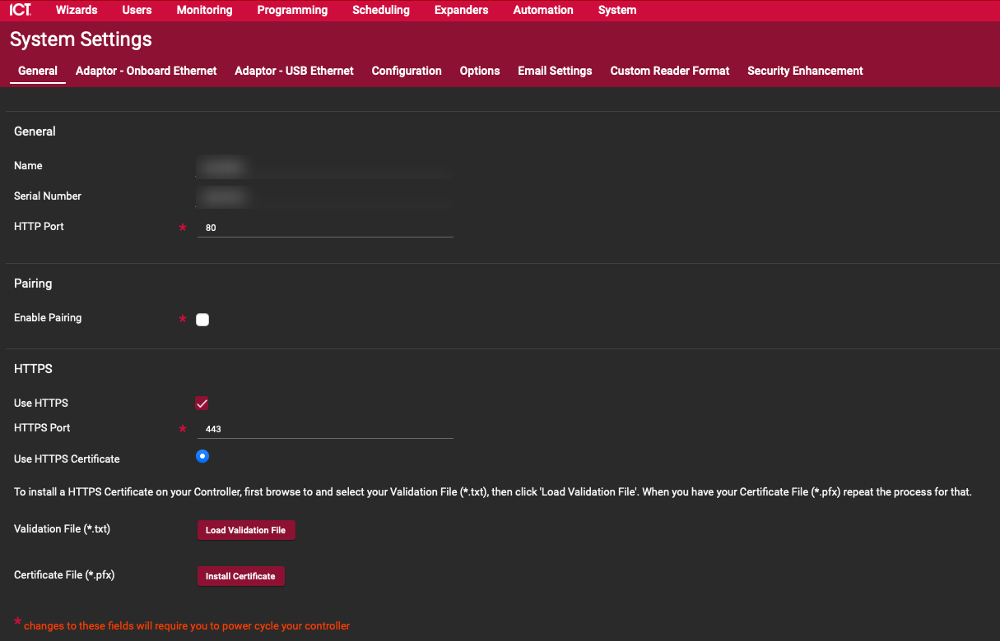
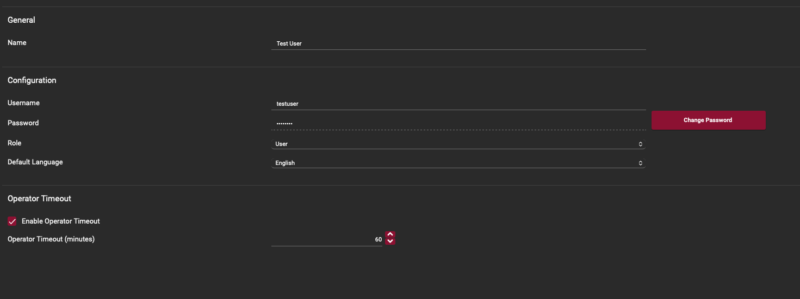
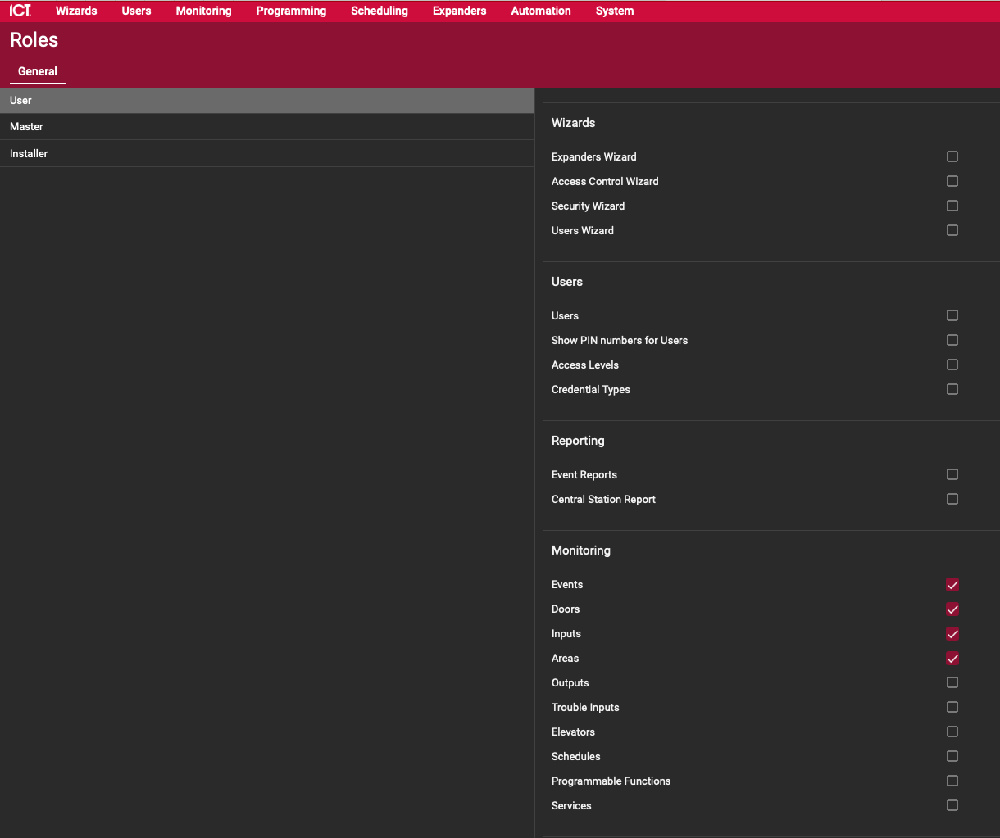

<p align="center">
  
</p>

# ICT Protege for Home Assistant

Control and monitor an **ICT Protege WX** security panel from Home Assistant, on your own network.
Doors, alarm areas, inputs (PIRs, reeds), outputs and trouble inputs are found and named automatically.

## Quick start

1. **On the panel**: turn on HTTPS and create a web interface operator for Home Assistant ([details](#1-web-interface-operator-everyone)).
   If your panel has the *Automation and Control* licence, also add a control service and a user with a PIN ([details](#2-control-service-licensed-panels-only)).
2. **Install** the integration with HACS:
   [](https://my.home-assistant.io/redirect/hacs_repository/?owner=caboose014&repository=ICT-Protege-Home-Assistant&category=integration)
3. **Add it** in Home Assistant and enter the panel's address and the operator login:
   [](https://my.home-assistant.io/redirect/config_flow_start/?domain=ict_automation)

Setup works out the rest. It checks whether the panel has the control service and uses it if so, otherwise it runs
through the web interface.

**You'll need**: Home Assistant 2025.1 or later, Protege WX firmware 4.00.1676 or later, and access to the panel's
programming (if you don't have it, your security installer can do the panel steps for you).

## Which way will it connect?

| | Control service | Web interface only |
| --- | --- | --- |
| Needs the *Automation and Control* licence | Yes | No |
| Updates | Instant (the panel pushes them) | Within about 2 seconds (the event log is polled) |
| Who checks arm and disarm codes | The panel | Home Assistant (or no code, your choice) |
| What you set up on the panel | Operator, control service, user PIN | Operator only |

Not sure whether your panel has the licence? Just add the integration. Setup tells you whether it found the control service.
If you get the licence later, the integration offers to switch over and keeps all your devices and entities.

> [!NOTE]
> [ha-protege-wx](https://github.com/olliemaller/ha-protege-wx) is another integration that works through the WX web interface.

## Setup on the panel

Everything here is done in the Protege WX web interface.

### 1. Web interface operator (everyone)

1. Turn on HTTPS: go to **System > System Settings > General**, tick **Use HTTPS** and leave the HTTPS port at `443`.
   Changing these fields needs a power cycle of the controller. Firmware 4.00.1676 or later is required.

   
2. Under **Users > Operators**, create an operator for Home Assistant with the **User** role. Use it only for Home Assistant, not for people.
   Leaving *Operator Timeout* on is fine: if the panel ends the session, the integration logs in again on its own.

   
3. Check the **User** role (on the **Roles** page) has what Home Assistant needs. If your panel only has the built-in
   User, Master and Installer roles, remember that changes to User apply to every operator with that role.

| Your panel | Rights the role needs |
| --- | --- |
| Has the control service | **View** programming only. The operator only reads names and zone settings, once at start-up and on Rescan, then logs out. |
| Web interface only | View status and the event log, plus **control** of the areas, doors, outputs and inputs (bypass) you want to use from Home Assistant. No programming or user management rights. |

   For web-only mode, tick these under **Monitoring**: **Events**, **Doors**, **Inputs**, **Areas**, **Outputs** and
   **Trouble Inputs**. Leave the Wizards, Users and Reporting boxes unticked.

   

### 2. Control service (licensed panels only)

Skip this section if your panel doesn't have the *Automation and Control* licence.

**a. Add the service.** Go to **Automation > Services**, add a service, and set:

| Setting | Value |
| --- | --- |
| Name | Anything, for example `HomeAssistant` |
| Service Type | Automation and Control |
| Service Mode | Start With Controller OS |
| IP Port | `21000` (any free port) |
| Encryption Level | None |
| Checksum Type | 8 Bit Sum |
| Numbers are Big Endian | **Off** (little endian) |
| Allow Status Requests When Not Logged In | **On** (required) |
| User Logon Lock Out Timer | Off |
| Ack Commands | **On** (required) |
| Expect Ack For Status Monitoring / Events, and both Resend options | **Off** |

<p>
  
  
</p>

The panel allows one connection per service, so give Home Assistant its own service rather than sharing one
used by another system (Savant, Control4 and so on).

**b. Add a user for Home Assistant.** Under **Users**, create a user with a PIN and rights to the doors, outputs and inputs
(for bypass) you want to control. Leave out arm and disarm rights: arming always asks for the person's own code.

**c. Event logging (optional).** To see who badged, what was unlocked, inputs and alarms in Home Assistant:

1. Add a **second** Automation and Control service with the same settings on another port, for example `HomeAssistantLogging` on `21001`.
2. Create a user with a PIN and **no control rights**. The integration stays logged in on this service only to receive events.

<p>
  
  
</p>

In web-only mode, events come from the web interface's event log, so there is nothing extra to set up.

## Install

**HACS** (recommended): click the button above, or add `https://github.com/caboose014/ICT-Protege-Home-Assistant` as a custom
repository (category *Integration*). Download **ICT Protege**, then restart Home Assistant.

**Manually**: copy `custom_components/ict_automation` into your Home Assistant `config/custom_components/` folder
(so you have `config/custom_components/ict_automation/manifest.json`), then restart Home Assistant.

## Setup in Home Assistant

1. Go to **Settings > Devices & services > Add integration > ICT Protege**.
2. Enter:
   * the controller's IP address
   * the operator name and password
   * the HTTPS port (usually `443`)
   * the control service port (usually `21000`; leave it as it is if you don't have the licence)
3. What happens next depends on your panel:
   * **Control service found**: enter the user PIN from step 2b. You can tick *Use the web interface only instead* if you prefer.
   * **No control service**: choose how arming codes work:
     * **Codes checked in Home Assistant** (recommended): afterwards, open **Configure** and add a name and code for each person.
     * **No code**: anyone who can use the alarm panel in Home Assistant can arm and disarm, so limit that with Home Assistant users.
4. Tidy up:
   * Put each door, input and output device in its Home Assistant area.
   * **Disable** any alarm area you don't use, for example a system area that only exists for monitoring.
   * On each area's device, turn off the **Allow arm …** switches for modes that area doesn't use.
   * Use *Show as* on inputs (motion, door, window, smoke) so they get the right icon.

**Check it worked**: your doors show as locked or unlocked, areas as armed or disarmed, and opening a door or walking past a
PIR changes its sensor within a couple of seconds.

**Configure** (the cog on the integration) has:

* **Control service**: the WX operator, and event logging (the events port and the events user's PIN).
* **Web interface only**: arming codes, and *Switch to the Automation and Control service*.

## What you get

| Panel record | Home Assistant |
| --- | --- |
| Panel | A controller device with a **Fault** sensor (on when a trouble input is active or an input is tampered), a **Rescan panel** button and a **Panel event** entity (control service: with event logging set up) |
| Door | A **lock** (lock, unlock latched, *open* = momentary unlock), a **contact** sensor and a **door state** sensor (closed, open, left open, forced open) |
| Area | An **alarm panel** (away = normal arm, home = stay, night = instant), **alarm** and **siren** sensors, **Open zones**, **Ready to arm**, and **Alarm cause** (the zone that set the alarm off, kept until disarm) |
| Input | A state sensor, a **Tamper** sensor and a **Bypass** switch |
| Output | A switch |
| Trouble input | A problem sensor on the controller, disabled by default |

Every door, area, input and output is its own device, so each can go in its own Home Assistant area. Inputs and outputs are
grouped under the module they are wired to. Names come from the panel; anything you rename in Home Assistant keeps your name.

**Open zones** and **Ready to arm** only count zones that must be closed for the area to arm. Zones that aren't tested at arming
(for example *Delay No Test*), 24-hour zones and trouble zones are left out. If an arm is refused, the error names the open zones.

**Duress, panic and medical** alarms raise a critical alert under **Settings > Repairs** until you mark it handled, and fire an
`ict_automation_emergency` event for automations. With the control service this needs event logging set up.

**Actions**: `ict_automation.force_arm` (alarm panel), `ict_automation.turn_on_for` (output, with a duration) and
`ict_automation.bypass` (bypass switch, optionally permanent).

### Seeing events

In web-only mode, or with event logging on the control service, every panel event appears in three places:

* The **Panel event** entity on the controller device, with `text`, `category` and `user` attributes.
  Its types are `access_granted`, `access_denied`, `armed`, `disarmed`, `alarm`, `door`, `input`, `output`, `user`, `trouble` and `other`.
* The **Activity** (logbook) page, as readable text such as *User Dave Entry Granted Front Door Using User By Card*.
* The `ict_automation_event` bus event, with `text`, `category`, `user` and `code`, for automations.

Card numbers are removed from event text so they don't end up in Home Assistant's history.

## Troubleshooting

**Setup**

* **"Couldn't reach the web interface … and no Automation and Control service answered"**: check the IP address, that HTTPS
  is enabled, and the HTTPS port.
* **"The web interface rejected this operator name or password"**: check the login works in a browser at `https://<controller>`.
* **"The panel rejected this PIN"**: check the user from step 2b exists and the PIN is right.
* **Expected the control service but got web-only**: check the service is set to *Start With Controller OS*, the port matches,
  and nothing else is connected to it.

**Control service**

* **Panel refused a request**: turn on *Allow Status Requests When Not Logged In* on the service.
* **Changes from other systems are slow to show**: check *Ack Commands* is on and both *Expect Ack* options are off.

**Web interface only**

* **A command is refused**: the operator's role doesn't have control rights for that door, area or output.
* **Asked to re-enter the operator password**: the panel rejected the saved password (for example after it was changed).
  The integration stops logging in so the operator doesn't get locked out; enter it again from **Settings > Devices & services**.
* **Entities unavailable**: the web interface can't be reached. The integration retries on its own.

**Getting details**: turn on debug logging from the integration's menu, reproduce the problem, then turn it off again.
PINs, passwords and codes are never written to the log, and **Download diagnostics** removes them too.

## FAQ

<details>
<summary>How does web-only mode stay connected without getting locked out?</summary>

It keeps one session open and only reads the event log, about every 2 seconds. It re-reads a status table when an event says
something in it changed, plus a full read every 30 seconds. The session is saved, so restarting Home Assistant carries on
with it instead of logging in again. If the session is dropped it logs in again, but never more than 6 times an hour,
backing off up to 10 minutes between tries. If the password is rejected it stops trying until you re-enter it.
It logs out when the integration is removed or reloaded.
</details>

<details>
<summary>How are PINs and codes used?</summary>

* **Control service**: the user PIN is only used for the moment a command is sent; the rest of the time the integration watches
  the panel without being logged in. Arming and disarming always ask for the person's own code, which goes straight to the
  panel and is never stored.
* **Web interface only**: the panel never sees a code, so Home Assistant checks it. Codes are stored only as salted hashes,
  and the person's name shows as *changed by* on the alarm panel.
* The **events user** (control service) has no control rights and is only used to receive events.
</details>

<details>
<summary>How do I switch from web-only to the control service?</summary>

Every 6 hours, and when you press **Rescan panel**, the integration checks whether the control service answers on the port
given at setup. When it does, **Settings > Repairs** offers to switch over. You can also do it any time from
**Configure > Switch to the Automation and Control service**. Enter the user PIN, and the same devices and entities carry on,
with their history. It never falls back to the web interface afterwards; if the service stops answering, entities show as
unavailable until it's back.
</details>

<details>
<summary>Do I need the <code>ACPUseDisplayOrder</code> command on the panel?</summary>

No. Without it the control service uses the same record IDs as the web interface, which the integration reads directly.
Panels that already have it set work too.
</details>

<details>
<summary>Is it secure?</summary>

Everything stays on your network. The controller uses a self-signed HTTPS certificate, so the integration doesn't verify it;
keep the controller on a network you trust. Like every Home Assistant integration, the logins are stored in Home Assistant's
config files, so anything that can read those (or an unencrypted backup) could use them. That's why the operator and user
should only have the rights Home Assistant needs.
</details>

<details>
<summary>Upgrading from 2.x</summary>

Just update and restart: existing installs keep running on the control service with the same devices and entities.
To move between web-only and the control service, use **Configure > Switch to the Automation and Control service** rather
than deleting and re-adding the integration, because the two number some records differently and the switch maps them for you.
</details>

<details>
<summary>Upgrading from 1.x</summary>

Existing entries are migrated automatically: the connection details are kept, the old hand-entered doors, areas, inputs and
outputs are removed, and everything is re-created from the panel. Entity IDs change, so update dashboards and automations afterwards.
</details>

## Development

```bash
pip install -r requirements_test.txt
pytest
```

Tests run against a simulated panel (`tests/fake_panel.py`, built from ICT's *Automation and Control Service* protocol document)
and a simulated web interface (`tests/fake_web.py`). The protocol clients in `custom_components/ict_automation/protege/` have
no Home Assistant imports.
