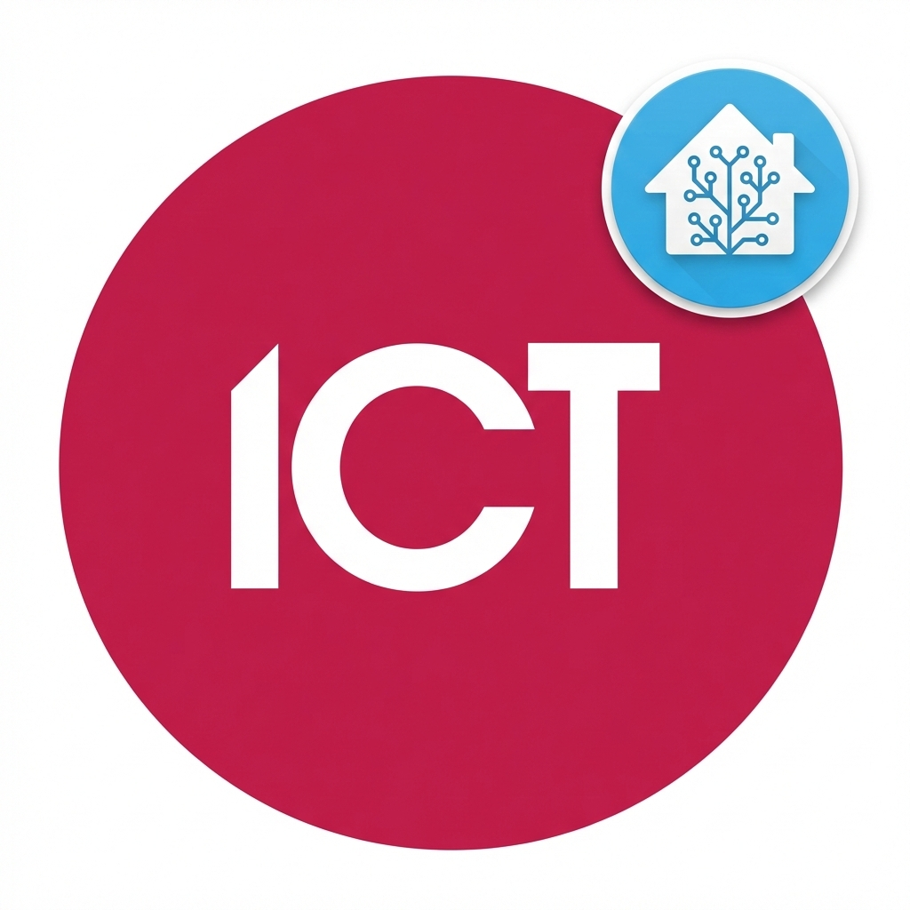

<p align="center">
  
</p>

# ICT Protege for Home Assistant

Local, push-based control of **ICT Protege WX** panels through the panel's Automation and Control service.
Enter the panel address and a PIN, and every door, area, input, output and trouble input is found and added automatically.

## What you get

| Panel record | Home Assistant |
| --- | --- |
| Panel | A controller device with firmware and serial, a **Rescan panel** button, and (optional) a **Panel event** entity |
| Door | A device with a **lock** (lock, unlock latched, *open* = momentary unlock), a **contact** sensor and a **door state** sensor (closed, open, left open, forced open) |
| Area | A device with an **alarm panel** (away = normal arm, home = stay, night = instant) plus **alarm** and **siren** sensors |
| Input | A binary sensor and a **bypass** switch, grouped under the module it is wired to (`CP001` on the controller, `ZX001` and so on for expanders). Use *Show as* in the entity settings to make it a door, window, motion or smoke sensor |
| Output | A switch |
| Trouble input | A diagnostic problem sensor, disabled by default |

Rename anything with Home Assistant's normal rename. Names default to the module reference, for example `Input ZX001:03`.
Pulling names from the WX web interface is planned.

Actions: `ict_automation.force_arm` (alarm panel), `ict_automation.turn_on_for` (output, with a duration) and
`ict_automation.bypass` (bypass switch, optionally permanent).

## How PINs are used

* **Integration PIN** (set during setup): a panel user with rights to doors, outputs and bypass. It does **not** need arm or disarm rights.
  The integration watches the panel without being logged in, and logs in with this PIN only for the moment it sends a command.
* **Arming and disarming** always ask for the person's own code, which goes straight to the panel. Home Assistant never stores it.
* **Events user** (optional): a view-only user with no control rights, used only on a separate events service (below).

When the panel refuses a command (wrong code, no rights, door in lockdown, input cannot be bypassed) the reason is shown in Home Assistant.

## Panel setup

In the WX web interface go to **Automation > Services**, add an *Automation and Control* service, and set:

| Setting | Value |
| --- | --- |
| IP Port | `21000` (any free port) |
| Encryption Level | None |
| Checksum Type | 8 Bit Sum |
| Numbers are Big Endian | **Off** |
| Allow Status Requests When Not Logged In | **On** (required) |
| Ack Commands | **On** (required) |
| Expect Ack For Status Monitoring / Events, Resend options | Off |

### Optional: event logging

To get panel events (entry granted, alarms, arming) as a Home Assistant event entity and `ict_automation_event` bus events:

1. Add a **second** Automation and Control service with the same settings on another port, for example `21001`.
2. Create a panel user with no control rights for it.
3. In Home Assistant open the integration's **Configure** and enter that port and PIN.

The integration stays logged in on that service only to receive events, and never sends commands through it.

### Optional: names from the WX web interface

The control service carries no names, so the integration can read them from the
controller's web interface instead. Enable HTTPS on the controller, create a WX
operator that can only view programming, and enter it under **Configure > Names
from the WX web interface**. Names are read on every start and when you press
**Rescan**; anything you rename in Home Assistant keeps your name. Only the
session login and List requests are sent, so the operator never changes
programming. Requires firmware 4.00.1676 or later.

## Install

### Manual (side-load)

1. Copy `custom_components/ict_automation` into your Home Assistant `config/custom_components/` folder
   (so you have `config/custom_components/ict_automation/manifest.json`).
2. Restart Home Assistant.
3. **Settings > Devices & services > Add integration > ICT Protege**.

### HACS

Add this repository as a custom repository (category *Integration*), download **ICT Protege**, and restart.

### Upgrading from 1.x

Existing entries are migrated automatically: the connection details are kept, the old hand-entered doors, areas, inputs and outputs are
removed, and everything is re-created from the panel. Entity IDs change, so update dashboards and automations afterwards.

## Development

```bash
pip install -r requirements_test.txt
pytest
```

Tests run against a simulated panel (`tests/fake_panel.py`) built from ICT's *Automation and Control Service* protocol document.
The protocol client in `custom_components/ict_automation/protege/` has no Home Assistant imports.
